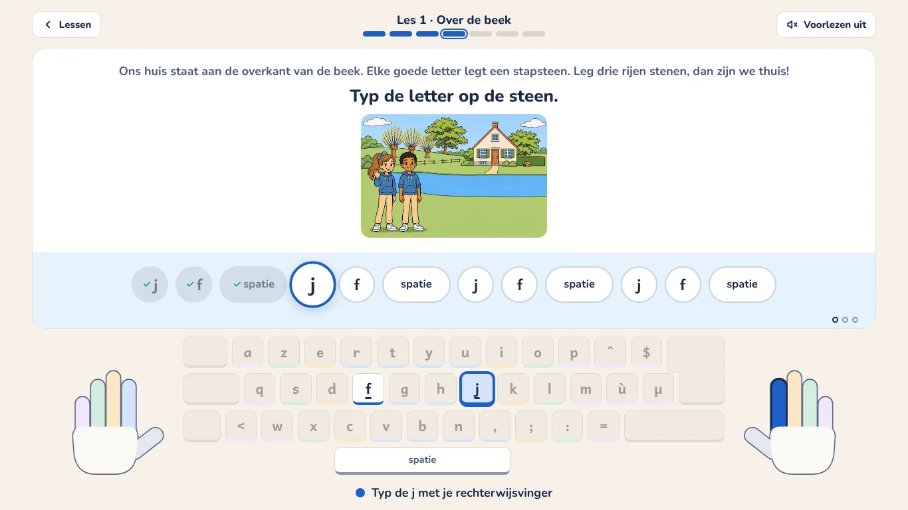
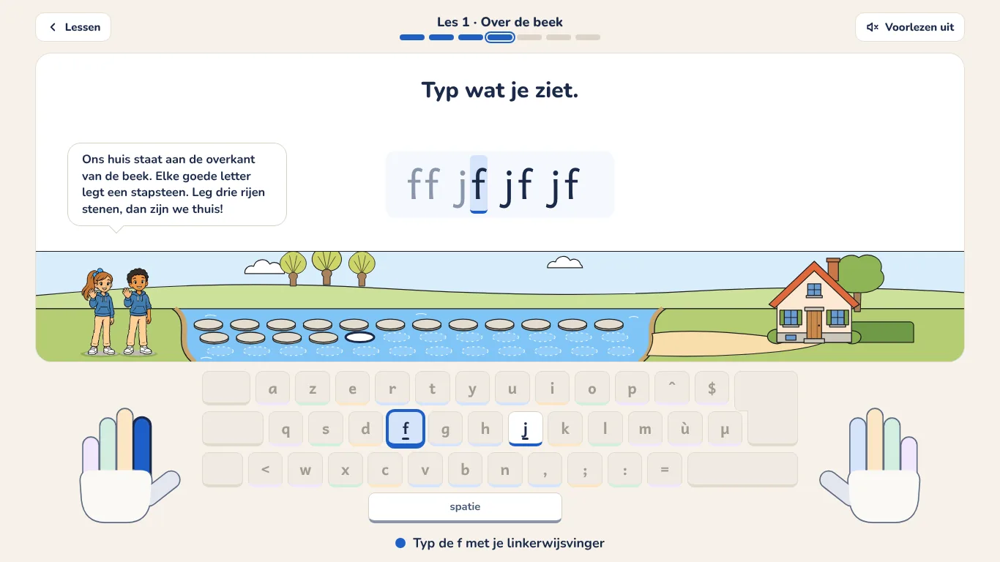
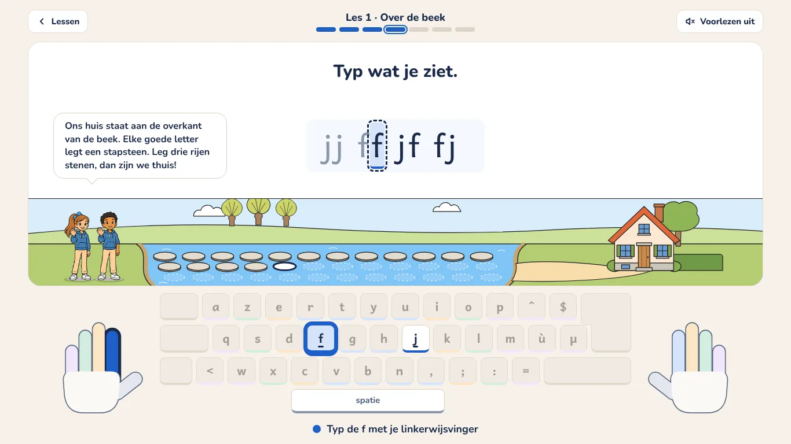
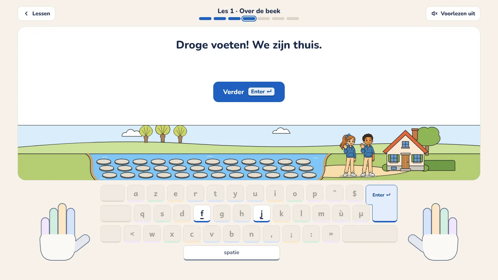
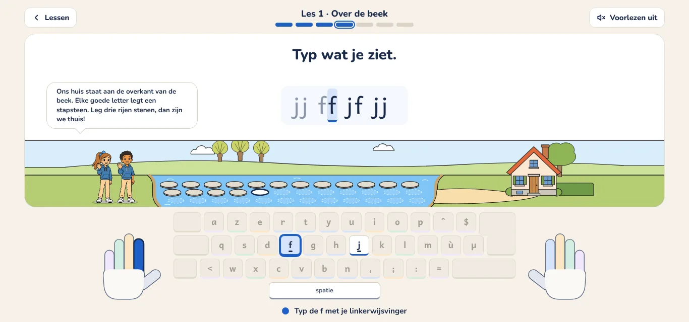

# Opdracht: het spelsjabloon, met "Over de beek" erin (K22)

Gevraagd door Nick op 27 november 2026 in de projectchat. Gebouwd op de tak `claude/spelsjabloon`, met Fable.

Opdrachten staan voortaan als bestand in deze map, zodat later terug te vinden is wat er gevraagd was en waarom (projectdocument 07, "Een schrijver tegelijk").

## Waarom

- De letter stond op de steen die aan de beurt was, klein, en schoof bij elke toets een plaats op.
- Een volwassene zonder uitleg vroeg: "Hoe ben ik aan het huis geraakt?" De prent toonde de reis niet.
- De spelletjes van les 2 tot 5 zijn nog niet gebouwd. Met een sjabloon is een nieuw spel een strook, een lijst en een slotzin.

## Wat Nick besliste, na een mockup

1. **De app tekent de strook zelf**, zo gebouwd dat de achtergrond later een prent uit een beeldgenerator kan worden.
2. **De letters staan groot in het midden**, zoals bij de oefenregels, niet op de stenen.
3. **Op het einde zwaaien Fien en Jef bij hun huis.**
4. "Maak de prent zo mooi mogelijk."

## Wat er gebouwd is

- `src/spellen/sjabloon.ts`: de vaste indeling voor elk spel (opdracht, doelzin in een tekstballon, de regel in het midden, de strook, het slot).
- `src/spellen/beek-strook.ts`: de strook van "Over de beek", in drie lagen (achtergrond, stenen, Fien en Jef).
- `src/spellen/beek.ts`: het spel zelf, nu in het sjabloon. Drie regels van 12 tekens, 36 stenen.
- Teksten: de opdracht "Typ wat je ziet.", de slotzin "Droge voeten! We zijn thuis."
- De regels staan in `docs/stijlgids.md`, deel 11; het waarom in `docs/beslissingen.md`, 12l; de testvragen in `docs/testlijst.md`.

## Beelden

| | |
|---|---|
| Voor |  |
| Tijdens het spel |  |
| Bij een fout |  |
| Het einde |  |
| Op een lager scherm (1366 x 640) |  |

## Wat niet in deze opdracht zit

- De spelletjes van les 2 tot 5. Ze volgen dit sjabloon, elk met een eigen strook.
- K27 fase 2 (afsluiter, "Licht aan in het huis", toetsenbordcheck, startscherm). Eerst test een kind van 9 of 10 jaar; we pakken aan waar het over struikelt.
- Een test op een echte Chromebook.
